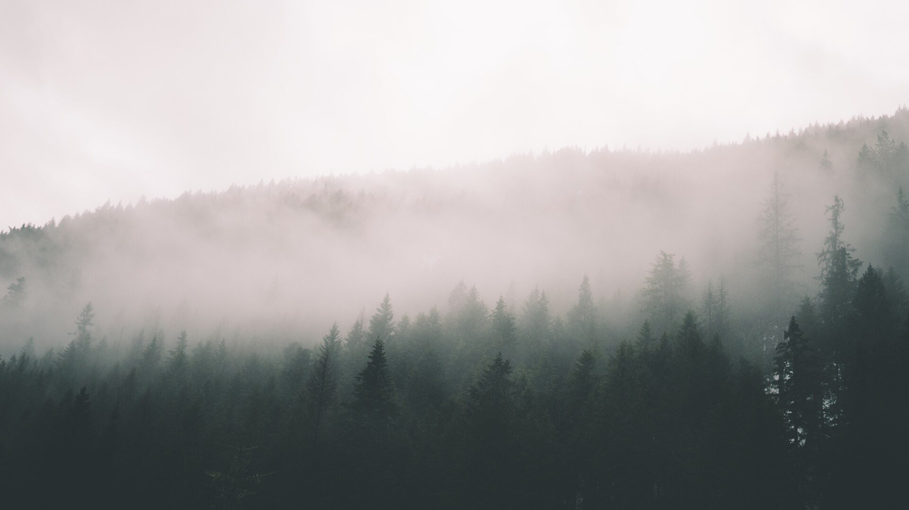
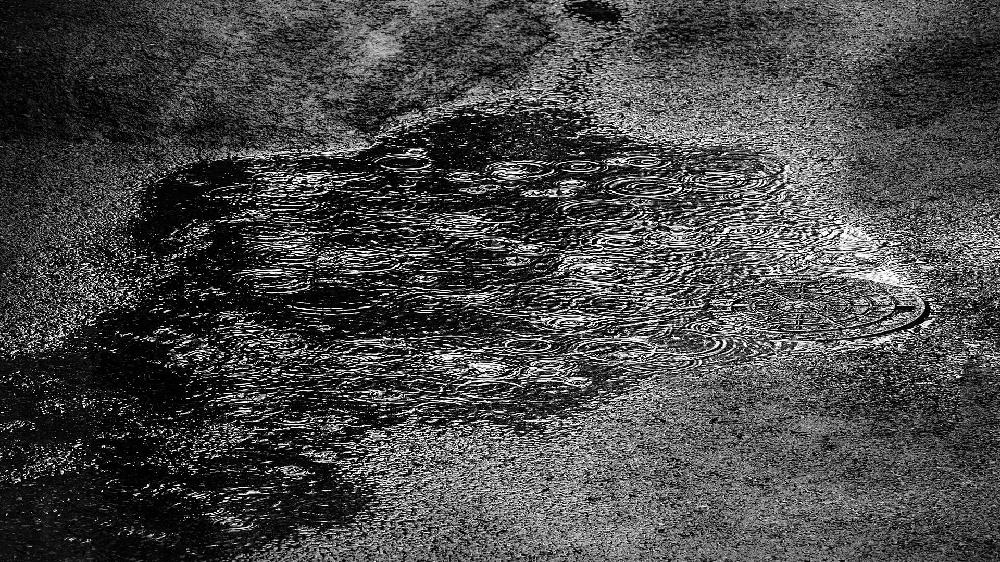
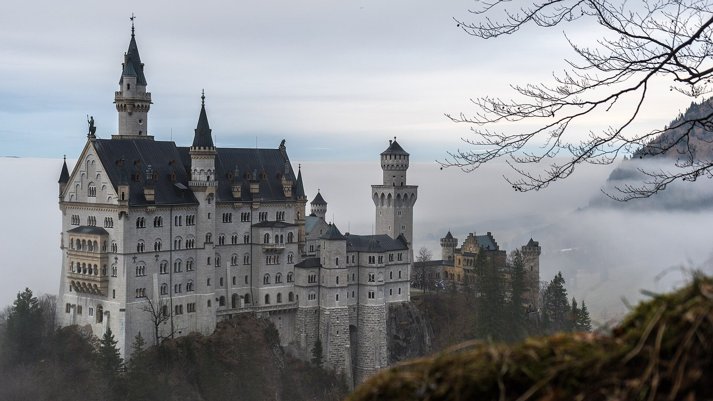
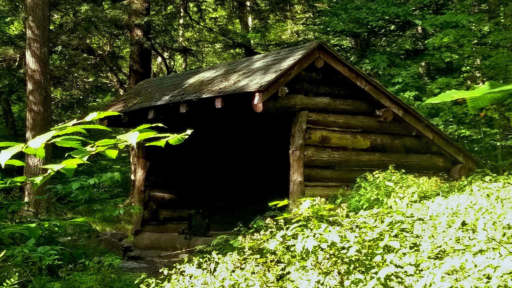
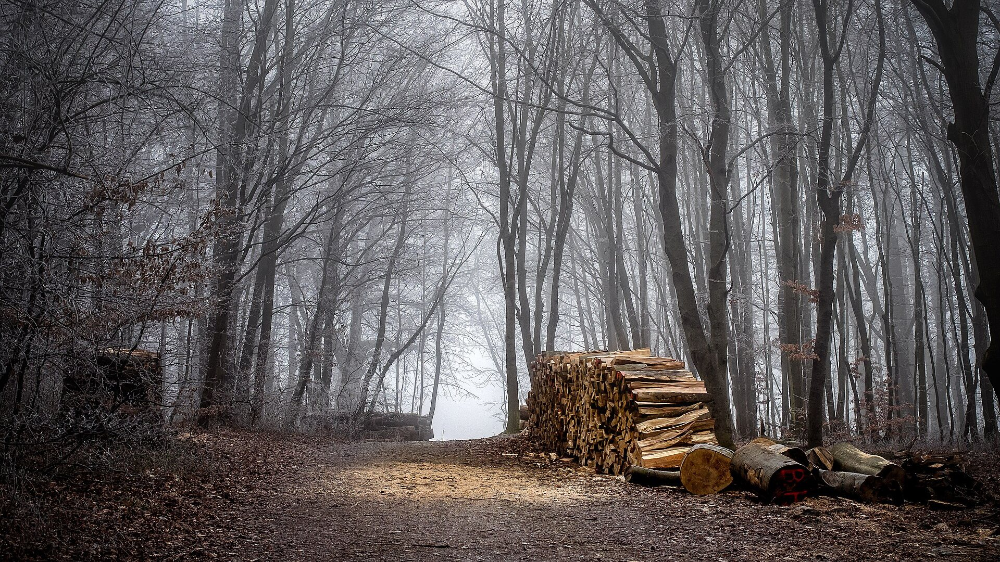
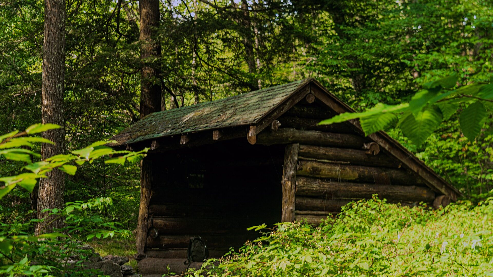
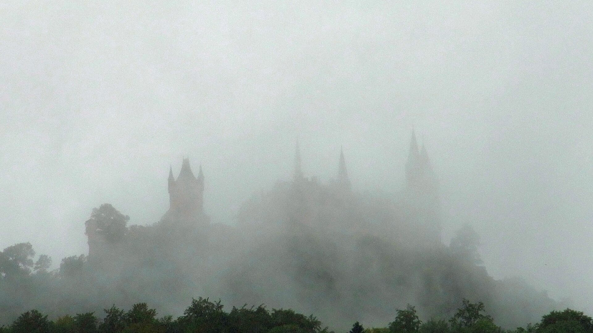
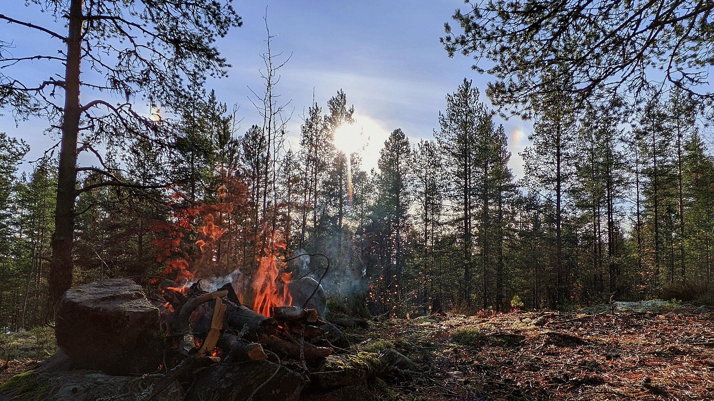

<!-- _class: cover -->
<!-- _paginate: false -->

MVP

# Gapahuken

Bygg en gapahuk, ikke et slott.

<!--
Velkommen. I dag skal vi snakke om å bygge minst mulig — og likevel løse problemet skikkelig. Vi begynner i skogen, i regnet.
-->

---

<!-- _class: photo center -->

Behovet

# Det regner.

<!--
La bildet virke et par sekunder. Det er kaldt, vått og mørkt. Ingen app, ingen strategi — bare vær.
-->

---

<!-- _class: photo right -->

Behovet

# Noen står ute i regnet.

Uten tak over hodet.

<!--
Dette er brukeren. Ikke en persona i et dokument, men et menneske som er våt nå. Behovet er ikke abstrakt.
-->

---

<!-- _class: statement -->

Behovet

# De trenger tak over hodet.

I natt. Ikke neste år.

<!--
Legg merke til hvor enkelt behovet er. Det er ikke «en bedre opplevelse av friluftsliv». Det er tak, i natt. Alt vi bygger, skal måles mot det.
-->

---

<!-- _class: statement center question -->

Spørsmålet

# Hva bygger vi?

<!--
Still spørsmålet til salen. La dem tenke. Svaret de gir — og det vi faktisk gjør — sier alt om hvordan vi tenker om produkt.
-->

---

<!-- _class: photo -->

Det ene svaret

# Slottet

Vollgrav. Tårn. Ballsal.  
Vinduer i blyglass.

*Ferdig om førti år.*

<!--
Det første svaret er alltid slottet. Det er imponerende, ambisiøst og lett å tegne. Det har bare én ulempe: det holder ingen tørre i natt.
-->

---

<!-- _class: statement -->

Behovet, igjen

# Ingen ba om et slott.

De ba om å holde seg tørre.

<!--
Dette er kjernen. Brukeren ba aldri om vollgrav, tårn eller ballsal. Vi la alt det til selv. Behovet var å holde seg tørr.
-->

---

<!-- _class: photo -->

Det andre svaret

# Gapahuken

Tre stokker. Litt granbar.  
Tak over hodet.

*Ferdig før det blir mørkt.*

<!--
Det andre svaret er nesten pinlig enkelt. Tre stokker, litt granbar, litt arbeid. Og det løser faktisk behovet — i kveld.
-->

---

<!-- _class: statement center -->
# Den er ikke fin.

Den er tørr.

<!--
Gapahuken vinner ikke noen designpris. Det er ikke poenget. Den er tørr. For brukeren er det hele forskjellen.
-->

---

<!-- _class: statement -->

Minimum viable product

# En MVP er ikke et halvferdig slott.

Det er en hel gapahuk — det minste som løser det virkelige behovet.

<!--
Dette er definisjonen vi skal huske. MVP er ikke «en dårlig versjon av det vi egentlig vil lage». Det er en komplett, liten løsning på det virkelige behovet.
-->

---

<!-- _class: photo -->

Testen

# Testen er ikke et møte.

Det er en natt i regnet.

<!--
Vi kan diskutere gapahuken i timevis. Men svaret får vi først når noen sover ute i regnet. Ekte bruk slår alle presentasjoner.
-->

---

<!-- _class: photo -->

Iterasjon

# Vinden kommer fra siden.

Så bygger du én vegg. Og sover ute igjen.

<!--
Første natt avslører noe ingen møterom hadde fortalt oss: vinden kommer fra siden. Løsningen er ikke å bygge et slott. Det er én vegg.
-->

---

<!-- _class: statement -->

Iterasjon

# Du bygger ikke et slott.

Du bygger én vegg.

Gapahuk → vegg → hytte. Bare når behovet endrer seg.

<!--
Slik vokser et produkt: ett tiltak om gangen, drevet av noe vi faktisk har lært. Gapahuken blir en gapahuk med vegg. Kanskje en hytte senere — men bare hvis behovet endrer seg.
-->

---

<!-- _class: list -->

Fordelene

# Derfor virker det.

1. **Raskere.** Brukeren blir tørr i dag.
2. **Billigere.** Du bygger bare det som trengs.
3. **Klokere.** Virkelig regn slår ethvert møte.
4. **Enklere.** Mindre å bygge. Mindre å vedlikeholde.

<!--
Fire grunner, egentlig fire sider av samme sak: du kommer raskere i gang, bruker mindre, lærer av virkeligheten og sitter igjen med noe som er lettere å holde i live.
-->

---

<!-- _class: photo light -->

Fellen

# Et slott som ikke er ferdig, holder ingen tørre.

<!--
Dette er fallet. Vi bruker årevis på noe stort og uferdig, mens brukeren fortsatt står i regnet. Et uferdig slott er ikke en halv løsning. Det er ingen løsning.
-->

---

<!-- _class: steps -->

Oppskriften

# Fire steg.

01<h3>Finn regnet.</h3>
Behovet

02<h3>Bygg taket.</h3>
MVP

03<h3>Sov ute.</h3>
Testen

04<h3>Bygg på.</h3>
Når behovet endrer seg

Det er hele metoden.

<!--
Hvis dere bare husker én slide, er det denne. Finn det virkelige behovet. Bygg den minste løsningen som dekker det. Test den i virkeligheten. Bygg videre bare når behovet endrer seg.
-->

---

<!-- _class: photo right -->

Til slutt

# Bygg gapahuken først.

<em>Slottet kan vente.</em>

<!--
Avslutt rolig. Gapahuken først. Slottet kan komme senere — hvis noen fortsatt trenger det.
-->

---

<!-- _class: statement center question -->
<!-- _paginate: false -->

# Hva er ditt slott?

Takk.

<!--
Siste spørsmål til salen: hva bygger dere som er for stort, for tidlig? Takk for meg.
-->

---

<!-- _class: credits -->
<!-- _paginate: false -->

# Kilder

<strong>Misty Mountains</strong> James Bloedel · CC0

<strong>Rain on a puddle</strong> W.carter · CC BY-SA 4.0

<strong>Beyond the fog</strong> Jorge Fernández · CC0

<strong>Palace Neuschwanstein</strong> Mathias Konrath · CC0

<strong>Biscuit Brook Lean-To</strong> Daniel Case · CC BY-SA 4.0

<strong>Aftermath of an ice rain</strong> Simon · CC BY 2.0

<strong>Biscuit Brook Lean-To 2</strong> Daniel Case · CC BY-SA 4.0

<strong>Burg Hohenzollern</strong> Rainer Halama · CC BY-SA 4.0

<strong>Bonfire and Sun</strong> Egor Plenkin · CC BY 2.0

Alle bilder er hentet fra Wikimedia Commons. Lenker og lisensdetaljer står i README. Laget med Marp. Skrift: Cormorant Garamond og EB Garamond (SIL OFL).

<!--
Kreditering av bilder. Denne kan stå sist, eller skjules når dere presenterer.
-->
